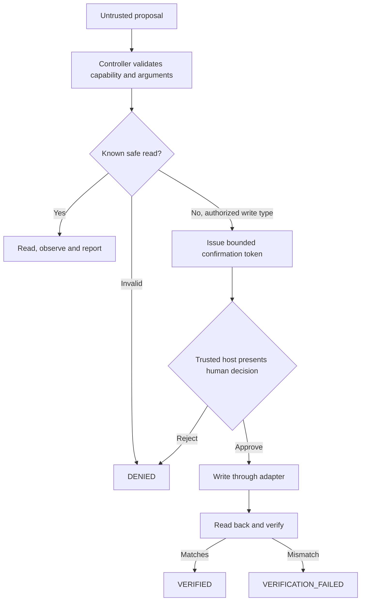

# Agent Governance Lab

A small, runnable **Python reference implementation** for safely orchestrating proposed tool actions.

The project demonstrates a narrow but important design principle from the NCMA/Jarvis work:

**Model suggestions are not execution authority.**

It is a self-contained educational example, **not the Jarvis codebase**, not a production security framework and not a complete AI agent. No LLM, operating-system tools, external network or API credentials are required.

## What the code does

- Accepts proposed actions as untrusted data.
- Restricts actions to a fixed set of typed capabilities (`notes.read` and `notes.write`).
- Refuses malformed arguments, unknown tools and request-ID collisions.
- Requires an explicit confirmation step for writes.
- Associates confirmation tokens with a specific pending proposal.
- Executes through a minimal in-memory adapter and verifies writes by a separate read-back.
- Returns an honest `VERIFIED`, `WAITING_CONFIRMATION`, `DENIED`, `EXECUTION_ERROR` or `VERIFICATION_FAILED` outcome.
- Reuses a completed result for an identical request ID, rather than executing a duplicate mutation.



## Quick start

Requires **Python 3.11+**, with no third-party packages.

```bash
python demo.py
python -m unittest discover -s tests -v
```

## Repository layout

```text
governance.py              Controller, proposal and outcome contracts
demo.py                    User-visible, deterministic sample run
tests/test_governance.py   Guard, confirmation, replay and verification tests
.github/workflows/ci.yml  Continuous integration
```

## Security and realism boundaries

This lab has **no model, shell, file write, browser automation, persistence, identity provider or network**. The storage adapter is intentionally in-memory. Confirmation assumes a trusted user-interface host; a plain Python caller can impersonate that host. For a real product, identity, grants, expiration, concurrent claims, durable idempotency and audit storage must be independently engineered and tested.

Read-after-write verification checks the observed state of the demo adapter. It is **not** an independent external oracle and must not be confused with real-world effects.

## Why it exists

An LLM can generate the correct-looking call while selecting the wrong target, repeating a mutating request or reporting success without observing it. This example creates a small, testable boundary that makes those failures visible.

**Author:** [Valter Lourenço Junior](https://github.com/Ozzurac)

**Related engineering projects:** [NCMA Engineering](https://github.com/Ozzurac/ncma-engineering) · [Professional site](https://ncmasystems.com)

MIT-licensed original reference code. No private project source or operational credentials are included.